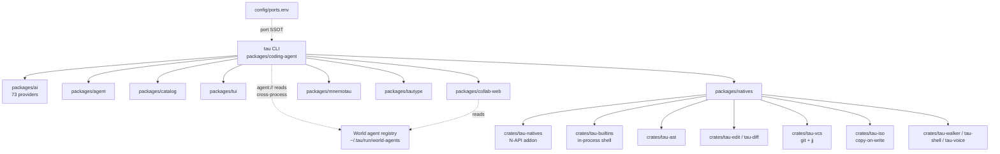

<div align="center">
<p align="center">
  <strong>tau — a coding agent with the IDE wired in.</strong>
</p>

<p align="center">
  Language: <strong>English</strong>
</p>

<p align="center">
          <a href="https://www.typescriptlang.org"></a>
  <a href="https://www.rust-lang.org"></a>
  <a href="https://bun.sh"></a>
  <a href="https://discord.gg/4NMW9cdXZa"></a>
</p>

<p align="center">
  Fork of <a href="https://github.com/can1357/oh-my-pi">oh-my-pi</a> (Pi by @mariozechner)
</p>

The most capable agent surface that ships. Continuously tuned by real-world use — complete out of the box, open all the way down.

**60+** providers · **31** built-in tools · **14** lsp ops · **28** dap ops · **~252k** lines of own+rebuilt Rust core.

# tau

**A coding agent that runs on your machine, in your processes, on your filesystem.**

[](crates/)
[](packages/)
[](packages/catalog/)
[](docs/tools/)
[](LICENSE)

</div>

---

**tau** is a terminal coding agent built for people who care what their agent
actually *does*. Not a chat wrapper around a hosted model — a real binary that
shells out, reads, edits, runs, and builds on the machine you already have.

Most agents fork `/usr/bin/grep` for every search. tau ships its own Rust
implementations and calls them **in-process**: 59 shell builtins, a BPE tokenizer
with 6 tokenizer families, git and jj drivers, copy-on-write file operations, and
a full AST editing layer — none of which spawn a subprocess.

It also knows what other agents are doing. Every session publishes its agent tree
to a **machine-wide registry**, so a second `tau` in another window can discover
this one and read its output through `agent://`.

```sh
cargo build -p tau-natives --release --features wayland-pipewire
bun --cwd=packages/natives run gen:native
bun --cwd=packages/coding-agent run build
./scripts/tau-pin --version   # verify pinned build
```

Full install, config, and architecture: [below](#table-of-contents).

---

## Table of contents

- [Features](#features)
- [Architecture](#architecture)
- [Quick start](#quick-start)
- [Machine-wide agent registry](#machine-wide-agent-registry)
- [Native addon](#native-addon)
- [Config & optional services](#config--optional-services)
- [Packages](#packages)
- [Extensions & skills](#extensions--skills)
- [Known gaps](#known-gaps)
- [Dev & contributing](#dev--contributing)
- [License & security](#license--security)

---

## Features

- **CLI + SDK** — `packages/coding-agent` ships the `tau` binary (`src/cli.ts`)
  and a programmatic SDK: read, bash, edit, write, grep, glob, task, and session
  management.
- **Stdio MCP Server (`tau-mcp`)** — Exposes Tau as an MCP server over stdio (`bin/tau-mcp.ts` $\to$ `~/.local/bin/tau-mcp`). Federates directly into gateways like Thresher (`:25127`) with `tau_prompt` (autonomous coding execution, verification, and diff application) and `tau_status`.
- **Programmatic Headless SDK** — Full programmatic control via `@tau/tau-coding-agent`: `createAgentSession`, `discoverModels`, `ModelRegistry`, `SessionManager`, and `SettingsManager` to embed Tau directly into custom pipelines without CLI harnesses.
- **Virtual Tool Devices (`xd://`)** — On-demand, zero-overhead tool-device discovery and invocation via internal URIs (`read xd://<tool>` for docs/schema, `write xd://<tool>` for execution).
- **73 models across 73 providers** — `packages/catalog` is the provider census;
  `packages/ai` carries **69 provider wire implementations**. Role-based routing:
  `smol`, `slow`, `plan`, `vision`, `task`, `advisor`, `tiny`. CLI flags `--smol`,
  `--slow`, `--plan`. Granular wire compat policies (`compat.allowEmptySignature`,
  `compat.replayUnsignedThinking`, etc.) ensure seamless replay across multi-provider gateways.
- **In-process shell, no fork/exec** — `crates/tau-builtins` provides 59 shell
  builtins (`grep`, `sed`, `cat`, `find`, `fd`, `rg`, `head`, `tail`, `tee`, `cut`,
  `wc`, `xargs`, `date`, `sort`, `uniq`, …) plus 8 process-control builtins
  (`pgrep`, `pkill`, `pidwait`, `ps`, `top`, `sleep`, `timeout`, `nohup`) and 59
  utility commands, running **inside** the agent process.
- **Native AST editing** — `tau-ast` parses source for structural edits;
  `tau-edit`/`tau-diff` apply them surgically. Backed by the `ast-grep` and
  `ast-edit` tools.
- **Git and jj, native** — `crates/tau-vcs` drives both VCSes for diff, mutate,
  patch, and read operations.
- **Copy-on-write file ops** — `crates/tau-iso` speaks APFS clones, Linux reflinks,
  Btrfs, ZFS, overlayfs, and Windows block cloning (`apfs.rs`, `linux_reflink.rs`,
  `btrfs.rs`, `zfs.rs`, `overlayfs.rs`, `windows_block_clone.rs`).
- **Machine-wide agent registry** — every interactive session publishes its agent
  tree over a private Unix socket, so other `tau` processes on the box can
  **discover** and **read** it via `agent://` and `history://`. Not a monkey
  patch, not a central broker. See
  [Machine-wide agent registry](#machine-wide-agent-registry).
- **First-class subagents** — `task` fans out into isolated worktrees with typed
  results returned to the parent (`packages/agent`).
- **Memory engine** — `packages/mnemotau`: local SQLite memory for agents.
- **33 documented tools** — one doc per tool in `docs/tools/`: `bash`, `read`,
  `write`, `edit`, `grep`, `glob`, `find`, `task`, `lsp`, `debug`, `browser`,
  `computer`, `web_search`, `github`, `tts`, `memory_edit`, `checkpoint`, `rewind`,
  `ask`, `learn`, `eval`, `ast-grep`, `ast-edit`, `security_scan`, `todo`, and
  more.
- **First-class Wayland / Hyprland desktop automation** — native IPC socket integration (`.socket.sock`), multi-monitor client resolution, window activation via `hl.dsp.window.focusaddr`, and high-resolution `grim` region capture for CachyOS and Linux.
- **Symlink-aware context consolidation** — automatic canonical realpath deduplication and content identity consolidation for `AGENTS.md`, `CLAUDE.md`, and system prompt files across workspace and ancestor symlinks, pruning redundant tokens before paragraph indexing.
- **Live session collaboration** — `packages/collab-web` exposes `/collab` with a
  link and QR code; join via `tau join` or a browser, read-write or view-only.
- **Browser relay** — `packages/browser-relay` lets the browser tool drive your
  **existing** Chrome tabs via a Chrome extension.
- **Type-safe runtime schemas** — `packages/tautype`: ArkType-compatible runtime
  validation with lazy JIT compilation.
- **Snapcompact** — bitmap-frame context compression for vision-capable LLMs.
- **Observability & benchmarks** — `packages/stats` (local usage dashboard),
  `packages/metaharness` (benchmark runners, REST/SSE APIs, live dashboard).
- **Immutable binary pinning** — `scripts/tau-pin` resolves the fork root via
  `git rev-parse --show-toplevel`, `realpath`-checks containment, and refuses to
  fall through to PATH. Auto-update cannot clobber it.
- **Port SSOT** — `config/ports.env` is the single source of truth for every
  service port. Zero hardcoded ports in code.
- **Daemon supervision** — `pitchfork.toml` tracks `tau`, `herd`,
  `kimi-code`, `vansrouter`, `flock`, `nativelink`, and `mbx-cache`.
- **Upstream sync without merge anxiety** — `scripts/upstream-pull.ts` performs an
  ancestry-free entity merge across unrelated git histories (see
  [UPSTREAM-MERGE.md](docs/UPSTREAM-MERGE.md)).

---

## Architecture



---

## Quick start

```sh
cargo build -p tau-natives --release --features wayland-pipewire
bun --cwd=packages/natives run gen:native
bun --cwd=packages/coding-agent run build
./scripts/tau-pin --version   # pinned launcher — never clobbered by auto-update
```

Prefer the upstream binary untouched? `bun install -g @tau/tau-coding-agent` — but
you lose the ranch layer (pinned launcher, port SSOT, extensions).

---

## Machine-wide agent registry

`AgentRegistry` is **process-global**: one main agent plus its subagents, per OS
process. That makes `agent://` and `history://` invisible to a second `tau` on the
same machine. Registry 0x01 fixes that as a first-class feature.

Each interactive session publishes its agent tree — ids, kinds, statuses, session
files — to `~/.tau/run/world-agents`. Publication reuses the proven collab host
machinery: a private Unix socket, newline-delimited JSON, a per-publication bearer
token, and `sun_path` relocation for deep config roots. Discovery is a directory
scan; there is no central broker and nothing to reconnect to.

Consequences:

- **`agent://<id>` reads across processes.** A peer's artifacts live beside its
  own transcript, so its directory joins the scan — but *after* local directories,
  because a same-process agent is the one your session actually spawned.
- **A cross-process miss names the peer** (pid + cwd) instead of failing dead.
- **A dead process is pruned** by a pid-liveness probe, so the roster self-heals.
- **Publication failure never blocks startup.** If the endpoint can't be created,
  the bridge logs and degrades to in-process behavior.

Writes stay local to the process's own registry on purpose — cross-process
delivery needs a durable queue and exactly-once semantics that fire-and-forget
mailbox semantics don't provide, and faking it would fail worse than erroring.

`crates`/modules: `registry/world-registry-daemon.ts` (transport),
`registry/world-registry-bridge.ts` (session glue). Tests in
`test/world-registry.test.ts` cover the real cross-process case.

---

## Native addon

`crates/tau-natives` is an N-API addon providing the BPE tokenizer (six tokenizer
families, linkable per-family), the shell runtime, and the file/VCS primitives.

**Tokenizer families** are compile-time features — every family is linked by
default (~5 MB of compressed vocabulary); opt out per family to slim a binary that
only serves one model, the same trade `rust-tiktoken` makes.

**Wayland screencast** is gated behind `--features wayland-pipewire`. It's off by
default because the pipewire crate hard-links system `libpipewire-0.3` via
pkg-config, which no CI/cross triple (musl, arm64) can satisfy. Without the
feature, Wayland capture calls fail at runtime with *"Wayland capture requires the
wayland-pipewire feature"*. Linux devs who want screencast opt in explicitly:

```sh
cargo build -p tau-natives --release --features wayland-pipewire
bun --cwd=packages/natives run gen:native      # embed into dist
bun --cwd=packages/coding-agent run build
```

**Important:** `dist/tau` embeds the addon and re-extracts it to
`~/.tau/natives/<version>/` on every launch, so patching that directory never
sticks. The supported path is a cargo build → `gen:native` → rebuild above.

---

## Config & optional services

| Service | Port | What it does |
|---|---|---|
| `HERD` | 25100 | local model server (formerly llama-swap) |
| `KIMI_CODE` | 25126 | Kimi code backend |
| `VANSROUTER` | 20128 | source-owned OpenAI-compatible router |
| `FLOCK` | 25193 | Flock cloud model gateway |
| `NATIVELINK` | 25155 / 25157 | high-performance Bazel REAPI build server & remote cache |
| `MBX_CACHE` | 25148 | mise remote task cache |
| `QDRANT` | 25133 | vector store (gRPC 25134) |
| `CUTTINGGATE` | 25200 | guard plane for herd (:25100) & flock (:25193); circuit breaker & quarantine |
| `THRESHER` | 25127 | MCP federation proxy & gateway |
Every port is defined once in `config/ports.env` and consumed from there —
nothing hardcodes a port in code. Ports are pulled by services via
`stack/lib-ports.sh` / `require_port`, and pitchfork daemons carry their port in
the `[daemons.*]` tables.

`packages/coding-agent` also ships `config/tau/extensions/vansrouter.ts` — a
source-owned OpenAI-compatible router on `:20128` with canonical `.secrets`
loading and provider-path collapsing (`nvidia/nvidia/foo` → `nvidia/foo`).

---

## Packages

| Package | What it is |
|---|---|
| `agent` | agent loop, subagent orchestration |
| `ai` | 73 providers, auth, streaming, hedging/retry |
| `browser-relay` | Chrome-extension relay so the browser tool drives real tabs |
| `catalog` | provider/model census and compatibility rules |
| `coding-agent` | the `tau` binary + SDK |
| `collab-web` | collab guest UI + local relay |
| `metaharness` | benchmark runners, REST/SSE APIs, live dashboard |
| `mnemotau` | local SQLite memory engine |
| `natives` | N-API addon build/embed pipeline |
| `snapcompact` | bitmap-frame context compression for vision models |
| `stats` | local observability dashboard |
| `tautype` | ArkType-compatible runtime validation (lazy JIT) |
| `tui` | terminal UI framework |
| `utils` | shared utilities, config-dir resolution |
| `wire` | shared wire-protocol types |
| `typescript-edit-benchmark` | edit-application benchmark suite |

---

## Extensions & skills

**Extensions** live in `ranch/tau-extensions/packages/`:

| Extension | What it does |
|---|---|
| `omp-edit-committer` | auto-commits every Edit/Write with intent + trade-off messages |
| `omp-kafka` | consumes Kafka topics into a session (push/pull) |
| `omp-model-router` | complexity-based routing across cheap/mid/expensive models |
| `rawhide` | slop-free prose linter and style engine |
| `tau-kimi-auto` | virtual `kimi-auto` model resolving to the best Kimi |
| `tau-omniroute` / `pi-omniroute-sync` | OmniRoute model sync for tau/pi/omp |
| `tau-loops` | reusable audit loops for the estate-scripts stack |

---

## Known gaps

`docs/MISSING-FEATURES.md` records every source-verified finding from the
2026-10-08 audit — features documented but never implemented (hedged streaming,
the hotfix registry, the `tack` provider generator) and features intended but
unbuilt. Each entry cites the command that proves the gap.

---

## Dev & contributing

```sh
bun setup
bun dev -- --version

# checks
bun run check:ts
bun run lint

# tests (TS + Rust + Python)
bun run test
```

---

## License & security

```
Copyright © 2025 Mario Zechner (upstream oh-my-pi / tau)
SPDX-License-Identifier: MIT
```

`LICENSE` · [`CONTRIBUTING.md`](CONTRIBUTING.md) ·
[`THIRD-PARTY-NOTICES.txt`](THIRD-PARTY-NOTICES.txt)

Reporting a vulnerability: open a private security advisory on the repository
rather than a public issue.

---

## Provenance

tau is a estate-scripts fork of [oh-my-pi](https://github.com/can1357/oh-my-pi).
Version identity: `<upstream-base>+estate-scripts.tau.<fork-sha>` — regenerated by
`helpers/gen-version.sh` into
`packages/coding-agent/src/generated/version.json` (currently
`18.8.4+estate-scripts.tau.*`; base advances with each absorbed upstream release).
The lineage is welded to upstream at seed commit `e16ba790b9` via a git
replace-graft, and upstream releases are absorbed through
`scripts/upstream-pull.ts` (weave/suture entity merge, digest-gated). The
fork's own deltas — extensions, port SSOT, agents, skills, the ranch layer —
are catalogued in `FORK_MANIFEST.tsv`. See
[UPSTREAM-MERGE.md](docs/UPSTREAM-MERGE.md) for the merge workflow and
[`MIRROR-DIFF-vs-upstream.md`](MIRROR-DIFF-vs-upstream.md) for the delta census.

---

<div align="center">
<sub>Built on the ranch · estate-scripts fork of oh-my-pi</sub>
</div>
## Install

**macOS · Linux**

```sh
# see Quick start (source build)
```

Without a usable bun (or with `--binary`), the install scripts fetch the prebuilt binary from `build.stencil.so` and check its SHA-256 before installing it. Pin a release with `# see Quick start (source build) -s -- --binary --ref v<version>` (PowerShell: `-Binary -Ref v<version>`).

> **Alpine / musl:** the prebuilt musl binary links `libstdc++`/`libgcc` dynamically, which stock Alpine does not ship. Install them first: `apk add libstdc++ libgcc`.

**Homebrew**

```sh
brew install can1357/tap/omp
```

**Bun (recommended)**

```sh
bun install -g @oh-my-pi/pi-coding-agent
```

**Nix**

```sh
# Run without installing
nix run github:can1357/oh-my-pi

# Or install into the active profile (Nix < 2.30: `nix profile install`)
nix profile add github:can1357/oh-my-pi
```

Flake consumers can use `packages.<system>.omp`, `overlays.default`, `nixosModules.default`, or `homeManagerModules.default`. A Home Manager configuration can install OMP and own its settings declaratively:

```nix
{
  inputs.omp.url = "github:can1357/oh-my-pi";

  # In your Home Manager module:
  imports = [ inputs.omp.homeManagerModules.default ];
  programs.omp = {
    enable = true;
    settings.startup.quiet = true;
  };
}
```

**Windows (PowerShell)**

```powershell
# Windows: build from source (see Quick start)
```

**Pinned versions (mise)**

```sh
mise use -g github:can1357/oh-my-pi
```

macOS · Linux · Windows · bun ≥ 1.4.4

### 08 · Read a pdf on arxiv, why not?

web_search chains twenty-four ranked providers and hands whatever URLs it finds straight to read. Arxiv PDFs, GitHub pages, Stack Overflow threads come back as structured markdown with anchors intact — the same tool surface you use on local files. Cite, follow, quote, never lose where you came from.


### 09 · Unapologetically native. Even on Windows.

Other agents shell out to rg, grep, find, and bash. On many machines those binaries don't exist, and on the ones where they do, every call costs a fork-exec round-trip. omp links the real implementations into the process. ripgrep, glob, find: in-process. The bash is our own bash 5.3 engine — with sessions that survive across calls, and 58 command-line utilities (ls, sed, sort, xargs, even jq) ported into the builtins crate and run in-process, zero fork/exec. The same omp binary runs on macOS, Linux, and Windows — no WSL bridge.

### 10 · Code review with priorities and a verdict

Get a clear verdict on whether the change ships, with every issue ranked P0 through P3 and scored for confidence. [/review](docs/slash-command-internals.md#15-bundled-command-note-review) spawns dedicated reviewer subagents that sweep branches, single commits, or uncommitted work in parallel. You tackle what blocks release first; nothing important hides in a wall of prose.

Want to steer the review yourself? `/annotate code-review` opens the diff so you can pin notes to lines before the reviewers run. `/annotate` also takes the latest reply, a session message, a file, or quoted text and pastes your notes into the prompt. See [`/annotate`](docs/slash-command-internals.md#12-bundled-command-note-annotate).

## Whatever the task needs, _it's already in the box_.

Core tools live in the same namespace as `read` and `bash`. Pin the active set with `--tools read,edit,bash,…`; rarely used discoverable tools stay behind `xd://` devices. `read xd://` lists them, and `write xd://<tool>` runs one when `tools.xdev` is enabled.

**Files & search**

- `read` — files, dirs, archives, SQLite, PDFs, notebooks, URLs, remote `ssh://` paths, and internal `://` schemes through one path.
- `write` — create or overwrite a file, archive entry, or SQLite row.
- `edit` — hashline patches with content-hash anchors and stale-anchor recovery.
- `ast_edit` — structural rewrites previewed before apply, via ast-grep.
- `ast_grep` — structural code queries over 50+ tree-sitter grammars.
- `grep` — regex over files, globs, and internal URLs.
- `glob` — glob-based path lookup; reach for `grep` when you need content matches.

**Runtime**

- `bash` — workspace shell with 46 in-process coreutils, optional PTY, and background-job dispatch.
- `eval` — persistent Python and JavaScript cells with shared prelude and tool re-entry.

**Code intelligence**

- `lsp` — diagnostics, navigation, symbols, renames, code actions, raw requests.
- `debug` — drive a DAP session — breakpoints, stepping, threads, stack, variables.
- `security_scan` — plan and run native security reviews; drives Codex Security cloud scans.

**Coordination**

- `task` — fan out subagents in parallel, optionally workspace-isolated.
- `wait` — block until the next background result, peer message, or steering interrupt; message peers and control jobs via `agent://` and `proc://`.
- `todo` — ordered mutations over the session todo list with phase tracking.
- `ask` — structured follow-up questions for interactive runs.

**Desktop & web**

- `browser` — Puppeteer tabs over headless Chromium, CDP-attached apps, or your own Chrome via the relay.
- `computer` — persistent JS against the host desktop: windows, screenshots, native input, AX tree, clipboard.
- `web_search` — one query across configured providers, returning answer plus citations.
- `github` — GitHub CLI ops — repo, PR, issues, code search, Actions run-watch.
- `generate_image` — generate or edit raster images via Gemini, GPT, or xAI Grok image models.
- `tts` — text-to-speech via xAI Grok Voice — five built-in voices, WAV or MP3.

**Memory & skills**

- `checkpoint` — mark conversation state for a later collapse-and-report.
- `rewind` — prune exploratory context, keep a concise report.
- `retain` — queue durable facts into the active memory bank.
- `recall` — search the memory bank for raw memories.
- `reflect` — synthesize an answer over the bank.
- `memory_edit` — update, forget, or invalidate stored memories by id.
- `learn` — capture a reusable lesson; optionally promote it into a managed skill.
- `manage_skill` — create, update, or delete an isolated managed skill.

Setting-gated, off by default: `github`, `security_scan`, `generate_image`, `tts`, `checkpoint`, `rewind`, and the memory tools (`retain`/`recall`/`reflect`/`memory_edit`, per `memory.backend`).

(see `packages/coding-agent/docs` for the full tool reference)

### Prompt controls

Standalone, lowercase words opt a turn into specialized agent behavior:

- `ultrathink` — request careful multi-step reasoning and the highest supported automatic thinking effort.
- `chillax` — request brief reasoning; on models with per-message effort, drop thinking to the lowest effort, even mid-turn.
- `orchestrate` — run substantial independent work through parallel subagents and verify each phase.
- `workflowz` — build a deterministic multi-subagent workflow with the active `task` tool.

They trigger only in prose, not inside code spans, fenced code blocks, XML/HTML sections, identifiers, or paths. See [Magic keywords](docs/magic-keywords.md) for exact matching rules and configuration.

### Frontier APIs

Direct APIs and gateways. Mix providers per role.

Anthropic `oauth` · OpenAI · OpenAI Codex `oauth` · Google Gemini · Google Vertex · Google Antigravity `oauth` · xAI · SuperGrok `oauth` · DeepSeek · Mistral · Groq · Cerebras · SambaNova · Fireworks · Together · Modular · Baseten · DeepInfra · Hugging Face · NVIDIA · Meta · Inception · Amazon Bedrock · Azure OpenAI · SiliconFlow · GMI Cloud · CoreWeave · Sakana AI · Command Code · Charm Hyper · StepFun · Helmcode · OpenRouter · Synthetic · Vercel AI Gateway · Cloudflare AI Gateway · Wafer Serverless · Scaleway

### Custom OpenAI-compatible providers

Define custom providers in `~/.omp/agent/models.yml`:

```yaml
providers:
   spark:
      baseUrl: http://192.168.10.223:8000/v1
      api: openai-completions
      apiKey: dummy
      models:
         - id: minimax-m3
           name: MiniMax M3
           contextWindow: 100000
           maxTokens: 32000
```

Run `omp models spark` to verify discovery. Then run `omp setup` and choose the model in the default-model step, or open `/model` in a session and assign it to the `default` role.

To preconfigure the default without the picker, add the selector to `~/.omp/agent/config.yml`:

```yaml
modelRoles:
   default: spark/minimax-m3
```

### Four knobs that make routing useful

- **Custom providers** — Declare anything that speaks `openai-completions`, `openai-responses`, `openai-codex-responses`, `azure-openai-responses`, `anthropic-messages`, `bedrock-converse-stream`, `google-generative-ai`, `google-gemini-cli`, `google-vertex`, `typesafe`, `openrouter-decisions`, `openai-decisions`, or `workers-ai-systemone` (the judge APIs) in `~/.omp/agent/models.yml`.
- **Fallback chains** — Per-role or per-model chains under `retry.fallbackChains`. When the primary throws 429s or hits a quota wall, the next entry takes the rest of the turn — restored on cooldown.
- **Path-scoped models** — Scope `enabledModels` and `disabledProviders` entries to a `path:` prefix to pin a different model set on one repo without touching the global config. Scoped entries cover the path and everything under it.
- **Round-robin credentials** — Stack API keys per provider and the runtime rotates with session affinity and per-credential backoff. Useful when one key would burn its quota by lunch.

Full provider & routing reference in `packages/coding-agent/docs`.

## Twenty-four backends. _One tool the agent already knows_.

`web_search` is built in, not bolted on. `auto` walks a twenty-four-provider chain; pin one by name if you already pay for it. Behind every hit, site-aware extraction turns GitHub, registries, arXiv, Stack Overflow, and docs into structured markdown — anchors and link targets survive.

### Search providers

Twenty-four backends. Pin one, or let `auto` walk the chain in order.

| provider     | auth                                      |
| ------------ | ----------------------------------------- |
| `auto`       | chain                                     |
| `perplexity` | `PERPLEXITY_API_KEY` (anonymous fallback) |
| `gemini`     | oauth                                     |
| `anthropic`  | oauth                                     |
| `codex`      | oauth                                     |
| `xai`        | oauth or `XAI_API_KEY`                    |
| `zai`        | `ZAI_API_KEY`                             |
| `exa`        | `EXA_API_KEY` (or mcp)                    |
| `tinyfish`   | `TINYFISH_API_KEY`                        |
| `keenable`   | `KEENABLE_API_KEY` (keyless fallback)     |
| `jina`       | `JINA_API_KEY`                            |
| `kagi`       | `KAGI_API_KEY`                            |
| `tavily`     | `TAVILY_API_KEY`                          |
| `firecrawl`  | `FIRECRAWL_API_KEY` (keyless fallback)    |
| `brave`      | `BRAVE_API_KEY`                           |
| `kimi`       | `/login kimi-code` or search key          |
| `parallel`   | `PARALLEL_API_KEY`                        |
| `synthetic`  | `SYNTHETIC_API_KEY`                       |
| `searxng`    | self-hosted                               |
| `duckduckgo` | no key                                    |
| `startpage`  | no key                                    |
| `google`     | no key (browser)                          |
| `ecosia`     | no key (browser)                          |
| `mojeek`     | no key (browser)                          |
| `public`     | no key (all of the above, consolidated)   |

Exa also accepts a stored API key through `/login exa`; explicit keyless selection uses the public MCP fallback.

## A fork that diverges *on purpose* — not a smaller omp.

Under the hood: **~252,000 lines of own+rebuilt Rust**, ten crates, one platform-tagged
N-API addon. Search, shell, AST, highlight, PTY, desktop control, image decode, BPE
counting — all in-process on the libuv pool. No fork/exec on the hot path. The shell is our
own bash 5.3 engine, 58 command-line utilities compiled straight into it.

The honest picture vs upstream `can1357/oh-my-pi` (tracked live by the estate's `omp-wtf`
audit): can1357 out-commits us on volume (≈8,400 vs ≈160 commits/30d — it is a firehose we
deliberately do not chase). Our edge is not volume. It is **decisions upstream hasn't made**:

- **A superset tool surface, never a subset.** Our read/grep are the upstream tools PLUS the
  virtual-resource layer the estate runs on: `artifact://`, `skill://`, sqlite, archives
  (zip/tar/asar), line-ranges, hashlines. 106/106 grep-family contracts pinned both modes.
- **`!glob` exclusion semantics as a choice, not a gap.** A literal `!notes.txt` on disk is
  legal POSIX — we refuse to make it unsearchable; upstream ripgrep-style prunes it. Both
  are runtime-selectable, pinned 9/9 by contract tests.
- **Per-pattern sed BRE fallback** — one bad `\|` pattern never kills a multi-expression sed;
  we degrade per-pattern, not per-call.
- **The native walker is a full parallel rewrite** (PassState, deferred oversized passes,
  streaming windows) — and the `exclude`/`recursive` plumbing gap that rewrite leaves is
  papered JS-side and tracked, never hidden.
- **Contract-test discipline:** we restored 172 upstream tool tests the fork once deleted —
  they are the A/B oracle proving every divergence is intentional, and the 93 still missing
  are fork-absent subsystems, not regressions.

Across the 2,789 divergent files, **not one is byte-identical** upstream — and our handful
of *ours-owned* rewrites (xdev.ts, env.ts, todo.ts, coercion.ts, the tool-call-loop guard)
run deeper per-file than the canary's. That is the fork's thesis: not "less upstream," but
**upstream velocity traded for deliberate, estate-specific depth.**


## Philosophy

omp is a fork of [pi-mono](https://github.com/badlogic/pi-mono) by [Mario Zechner](https://github.com/mariozechner), extended with a batteries-included coding workflow.

Key ideas:

- Keep interactive terminal-first UX for real coding work
- Include practical built-ins (tools, sessions, branching, subagents, extensibility)
- Make advanced behavior configurable rather than hidden

### Project inputs and trust

Opening a repository loads its project inputs by design: settings, extensions, hooks, tools, commands, skills, rules, and project MCP configuration. To exclude project `.mcp.json` for one invocation, pass `--config <file>` pointing at a YAML overlay with nested keys (a flat `mcp.enableProjectConfig: false` line is ignored):

```yaml
mcp:
   enableProjectConfig: false
```

Use `--no-extensions` to skip ambient extension discovery; or use `--trusted-extension /absolute/path/to/file.ts` for an exact extension allowlist. `--no-tools` disables built-in tools, but project tool modules remain a separate discovery surface. These flags narrow inputs without changing the repository-trust model.

---

### Getting started from source

Fresh clones need both workspace dependencies and the local Rust/N-API addon before the source CLI can start.

```sh
bun setup
bun dev
```

`bun setup` installs Bun workspaces and builds `@oh-my-pi/pi-natives`. Re-run `bun run build:native` after changing Rust crates or `packages/natives`.

Nix users get the pinned Bun and Rust toolchains plus all native build dependencies:

```sh
nix develop
bun setup
bun dev
```

Build and smoke-test the distributable Nix package with `nix build .#omp`. Wayland screencast support is off by default (linking libpipewire adds ~750 MB of runtime closure); enable it with `omp.override { withWaylandScreencast = true; }`. Release builds link `pi-natives` with fat LTO; `omp.override { withFatLto = false; }` uses thin LTO for much faster local rebuilds. Rust dependencies and the native addon build in separate derivations, so Rust edits reuse compiled dependencies and TypeScript edits reuse the addon. `nix/bun.nix` is generated only when `bun.lock` changes; releases regenerate it automatically. For dependency changes, run:

```sh
bun run gen:nix
```

The command uses `bun2nix` from `nix develop` when available, otherwise enters the development shell through Nix, then falls back to the pinned `bunx bun2nix@2.1.2`. Do not edit `nix/bun.nix` manually.

For a non-interactive smoke check:

```sh
bun dev -- --version
```

### Rust Crates

| Crate                                      | Description                                                                                              |
| ------------------------------------------ | -------------------------------------------------------------------------------------------------------- |
| **[pi-natives](crates/pi-natives)**        | Core Rust native addon (N-API `cdylib`) used by `@oh-my-pi/pi-natives`; aggregates the crates below      |
| **[pi-shell](crates/pi-shell)**            | Embedded bash 5.3 engine (parser, VM, process spawning, sessions), PTY, and process management           |
| **[pi-ast](crates/pi-ast)**                | tree-sitter-based code summarizer and AST utilities (50+ language grammars)                              |
| **[pi-iso](crates/pi-iso)**                | Task isolation backend resolver: APFS clones, btrfs/zfs reflinks, overlayfs, projfs, rcopy               |
| **[pi-voice](crates/pi-voice)**            | Audio capture/playback, Opus codecs, and live WebRTC streaming primitives                                |
| **[pi-walker](crates/pi-walker)**          | Parallel ignore-aware walker, directory-listing cache, glob, and content search for natives + shell      |
| **[pi-edit](crates/pi-edit)**              | Edit engine behind the `edit` tool: line-anchored patch/hashline modes, streaming previews, atomic apply |
| **[pi-builtins](crates/pi-builtins)**      | 67 in-process command-line utilities plus process builtins (ps, top, pgrep, pkill, …)                    |

## License

OMP is licensed under the [MIT License](LICENSE).

Third-party and vendored code, including the third-party portions identified
in `crates/pi-builtins/LICENSE`, remains under its respective upstream license.
Each shipped component carries its own `THIRD-PARTY-NOTICES.txt`: the CLI
(`packages/coding-agent`), the native addon (`packages/natives`), and robomp
(`python/robomp`). `omp --license` prints the CLI's and the addon's.

© 2025 Mario Zechner  
© 2025-2026 Can Bölük  
© 2026 [Stencil Labs, Inc.](https://stencil.so)

_made for terminals that stay open_


- [Stencil Labs](https://stencil.so)
- [GitHub](https://github.com/can1357/oh-my-pi)
- [Changelog](https://github.com/can1357/oh-my-pi/blob/main/packages/coding-agent/CHANGELOG.md)
- [npm](https://www.npmjs.com/package/@oh-my-pi/pi-coding-agent)
- [Discord](https://discord.gg/4NMW9cdXZa)
- [MIT](https://github.com/can1357/oh-my-pi/blob/main/LICENSE)
