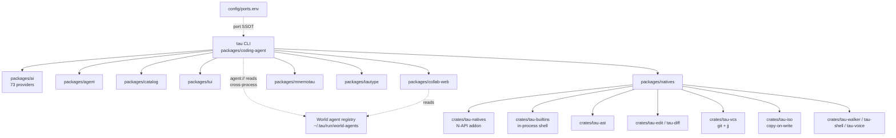
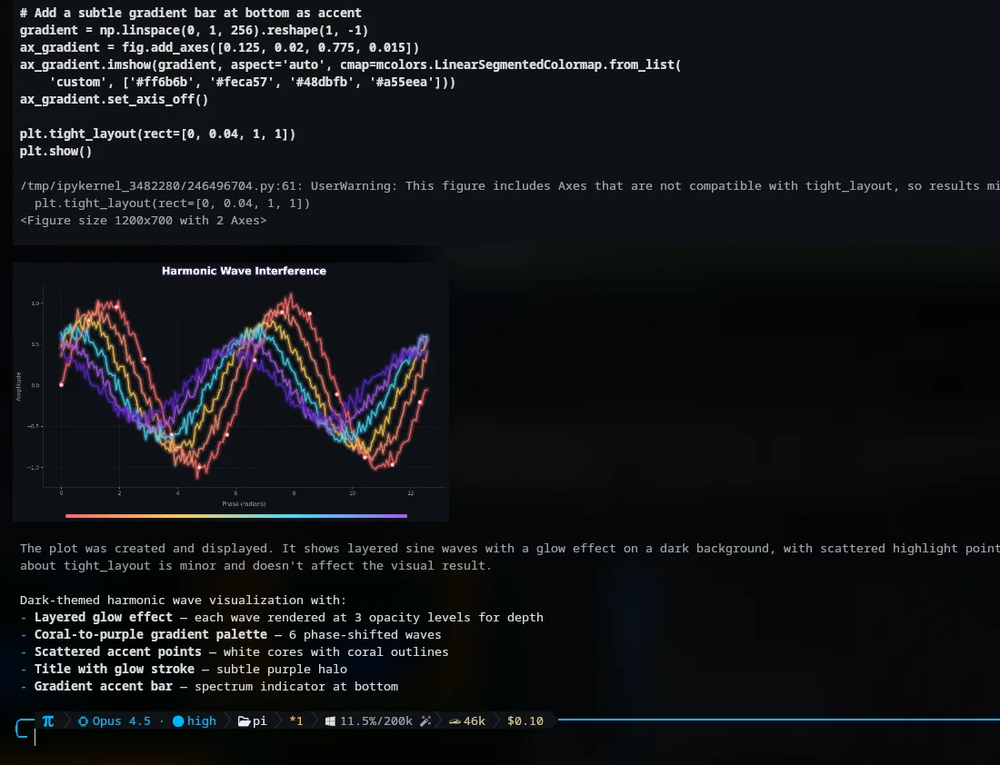
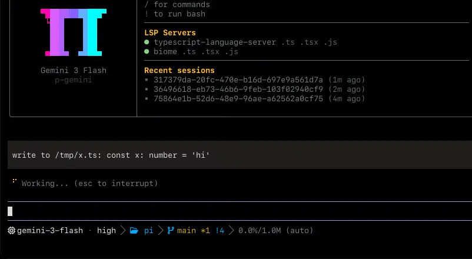
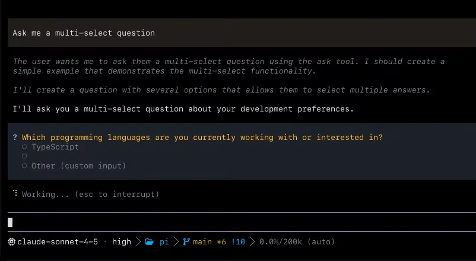

<div align="center">

# tau

**A coding agent that runs on your machine, in your processes, on your filesystem.**

[](crates/)
[](packages/)
[](packages/catalog/)
[](docs/tools/)
[](LICENSE)

</div>

---

**tau** is a terminal coding agent built for people who care what their agent
actually *does*. Not a chat wrapper around a hosted model — a real binary that
shells out, reads, edits, runs, and builds on the machine you already have.

Most agents fork `/usr/bin/grep` for every search. tau ships its own Rust
implementations and calls them **in-process**: 59 shell builtins, a BPE tokenizer
with 6 tokenizer families, git and jj drivers, copy-on-write file operations, and
a full AST editing layer — none of which spawn a subprocess.

It also knows what other agents are doing. Every session publishes its agent tree
to a **machine-wide registry**, so a second `tau` in another window can discover
this one and read its output through `agent://`.

```sh
cargo build -p tau-natives --release --features wayland-pipewire
bun --cwd=packages/natives run gen:native
bun --cwd=packages/coding-agent run build
./scripts/tau-pin --version   # verify pinned build
```

Full install, config, and architecture: [below](#table-of-contents).

---

## Table of contents

- [Features](#features)
- [Architecture](#architecture)
- [Quick start](#quick-start)
- [Machine-wide agent registry](#machine-wide-agent-registry)
- [Native addon](#native-addon)
- [Config & optional services](#config--optional-services)
- [Packages](#packages)
- [Extensions & skills](#extensions--skills)
- [Known gaps](#known-gaps)
- [Dev & contributing](#dev--contributing)
- [License & security](#license--security)

---

## Features

- **CLI + SDK** — `packages/coding-agent` ships the `tau` binary (`src/cli.ts`)
  and a programmatic SDK: read, bash, edit, write, grep, glob, task, and session
  management.
- **Stdio MCP Server (`tau-mcp`)** — Exposes Tau as an MCP server over stdio (`bin/tau-mcp.ts` $\to$ `~/.local/bin/tau-mcp`). Federates directly into gateways like Thresher (`:25127`) with `tau_prompt` (autonomous coding execution, verification, and diff application) and `tau_status`.
- **Programmatic Headless SDK** — Full programmatic control via `@tau/tau-coding-agent`: `createAgentSession`, `discoverModels`, `ModelRegistry`, `SessionManager`, and `SettingsManager` to embed Tau directly into custom pipelines without CLI harnesses.
- **Virtual Tool Devices (`xd://`)** — On-demand, zero-overhead tool-device discovery and invocation via internal URIs (`read xd://<tool>` for docs/schema, `write xd://<tool>` for execution).
- **73 models across 73 providers** — `packages/catalog` is the provider census;
  `packages/ai` carries **69 provider wire implementations**. Role-based routing:
  `smol`, `slow`, `plan`, `vision`, `task`, `advisor`, `tiny`. CLI flags `--smol`,
  `--slow`, `--plan`. Granular wire compat policies (`compat.allowEmptySignature`,
  `compat.replayUnsignedThinking`, etc.) ensure seamless replay across multi-provider gateways.
- **In-process shell, no fork/exec** — `crates/tau-builtins` provides 59 shell
  builtins (`grep`, `sed`, `cat`, `find`, `fd`, `rg`, `head`, `tail`, `tee`, `cut`,
  `wc`, `xargs`, `date`, `sort`, `uniq`, …) plus 8 process-control builtins
  (`pgrep`, `pkill`, `pidwait`, `ps`, `top`, `sleep`, `timeout`, `nohup`) and 59
  utility commands, running **inside** the agent process.
- **Native AST editing** — `tau-ast` parses source for structural edits;
  `tau-edit`/`tau-diff` apply them surgically. Backed by the `ast-grep` and
  `ast-edit` tools.
- **Git and jj, native** — `crates/tau-vcs` drives both VCSes for diff, mutate,
  patch, and read operations.
- **Copy-on-write file ops** — `crates/tau-iso` speaks APFS clones, Linux reflinks,
  Btrfs, ZFS, overlayfs, and Windows block cloning (`apfs.rs`, `linux_reflink.rs`,
  `btrfs.rs`, `zfs.rs`, `overlayfs.rs`, `windows_block_clone.rs`).
- **Machine-wide agent registry** — every interactive session publishes its agent
  tree over a private Unix socket, so other `tau` processes on the box can
  **discover** and **read** it via `agent://` and `history://`. Not a monkey
  patch, not a central broker. See
  [Machine-wide agent registry](#machine-wide-agent-registry).
- **First-class subagents** — `task` fans out into isolated worktrees with typed
  results returned to the parent (`packages/agent`).
- **Memory engine** — `packages/mnemotau`: local SQLite memory for agents.
- **33 documented tools** — one doc per tool in `docs/tools/`: `bash`, `read`,
  `write`, `edit`, `grep`, `glob`, `find`, `task`, `lsp`, `debug`, `browser`,
  `computer`, `web_search`, `github`, `tts`, `memory_edit`, `checkpoint`, `rewind`,
  `ask`, `learn`, `eval`, `ast-grep`, `ast-edit`, `security_scan`, `todo`, and
  more.
- **First-class Wayland / Hyprland desktop automation** — native IPC socket integration (`.socket.sock`), multi-monitor client resolution, window activation via `hl.dsp.window.focusaddr`, and high-resolution `grim` region capture for CachyOS and Linux.
- **Symlink-aware context consolidation** — automatic canonical realpath deduplication and content identity consolidation for `AGENTS.md`, `CLAUDE.md`, and system prompt files across workspace and ancestor symlinks, pruning redundant tokens before paragraph indexing.
- **Live session collaboration** — `packages/collab-web` exposes `/collab` with a
  link and QR code; join via `tau join` or a browser, read-write or view-only.
- **Browser relay** — `packages/browser-relay` lets the browser tool drive your
  **existing** Chrome tabs via a Chrome extension.
- **Type-safe runtime schemas** — `packages/tautype`: ArkType-compatible runtime
  validation with lazy JIT compilation.
- **Snapcompact** — bitmap-frame context compression for vision-capable LLMs.
- **Observability & benchmarks** — `packages/stats` (local usage dashboard),
  `packages/metaharness` (benchmark runners, REST/SSE APIs, live dashboard).
- **Immutable binary pinning** — `scripts/tau-pin` resolves the fork root via
  `git rev-parse --show-toplevel`, `realpath`-checks containment, and refuses to
  fall through to PATH. Auto-update cannot clobber it.
- **Port SSOT** — `config/ports.env` is the single source of truth for every
  service port. Zero hardcoded ports in code.
- **Daemon supervision** — `pitchfork.toml` tracks `tau`, `herd`,
  `kimi-code`, `vansrouter`, `flock`, `nativelink`, and `mbx-cache`.
- **Upstream sync without merge anxiety** — `scripts/upstream-pull.ts` performs an
  ancestry-free entity merge across unrelated git histories (see
  [UPSTREAM-MERGE.md](docs/UPSTREAM-MERGE.md)).

---

## Architecture



---

## Quick start

```sh
cargo build -p tau-natives --release --features wayland-pipewire
bun --cwd=packages/natives run gen:native
bun --cwd=packages/coding-agent run build
./scripts/tau-pin --version   # pinned launcher — never clobbered by auto-update
```

Prefer the upstream binary untouched? `bun install -g @tau/tau-coding-agent` — but
you lose the ranch layer (pinned launcher, port SSOT, extensions).

---

## Machine-wide agent registry

`AgentRegistry` is **process-global**: one main agent plus its subagents, per OS
process. That makes `agent://` and `history://` invisible to a second `tau` on the
same machine. Registry 0x01 fixes that as a first-class feature.

Each interactive session publishes its agent tree — ids, kinds, statuses, session
files — to `~/.tau/run/world-agents`. Publication reuses the proven collab host
machinery: a private Unix socket, newline-delimited JSON, a per-publication bearer
token, and `sun_path` relocation for deep config roots. Discovery is a directory
scan; there is no central broker and nothing to reconnect to.

Consequences:

- **`agent://<id>` reads across processes.** A peer's artifacts live beside its
  own transcript, so its directory joins the scan — but *after* local directories,
  because a same-process agent is the one your session actually spawned.
- **A cross-process miss names the peer** (pid + cwd) instead of failing dead.
- **A dead process is pruned** by a pid-liveness probe, so the roster self-heals.
- **Publication failure never blocks startup.** If the endpoint can't be created,
  the bridge logs and degrades to in-process behavior.

Writes stay local to the process's own registry on purpose — cross-process
delivery needs a durable queue and exactly-once semantics that fire-and-forget
mailbox semantics don't provide, and faking it would fail worse than erroring.

`crates`/modules: `registry/world-registry-daemon.ts` (transport),
`registry/world-registry-bridge.ts` (session glue). Tests in
`test/world-registry.test.ts` cover the real cross-process case.

---

## Native addon

`crates/tau-natives` is an N-API addon providing the BPE tokenizer (six tokenizer
families, linkable per-family), the shell runtime, and the file/VCS primitives.

**Tokenizer families** are compile-time features — every family is linked by
default (~5 MB of compressed vocabulary); opt out per family to slim a binary that
only serves one model, the same trade `rust-tiktoken` makes.

**Wayland screencast** is gated behind `--features wayland-pipewire`. It's off by
default because the pipewire crate hard-links system `libpipewire-0.3` via
pkg-config, which no CI/cross triple (musl, arm64) can satisfy. Without the
feature, Wayland capture calls fail at runtime with *"Wayland capture requires the
wayland-pipewire feature"*. Linux devs who want screencast opt in explicitly:

```sh
cargo build -p tau-natives --release --features wayland-pipewire
bun --cwd=packages/natives run gen:native      # embed into dist
bun --cwd=packages/coding-agent run build
```

**Important:** `dist/tau` embeds the addon and re-extracts it to
`~/.tau/natives/<version>/` on every launch, so patching that directory never
sticks. The supported path is a cargo build → `gen:native` → rebuild above.

---

## Config & optional services

| Service | Port | What it does |
|---|---|---|
| `HERD` | 25100 | local model server (formerly llama-swap) |
| `KIMI_CODE` | 25126 | Kimi code backend |
| `VANSROUTER` | 20128 | source-owned OpenAI-compatible router |
| `FLOCK` | 25193 | Flock cloud model gateway |
| `NATIVELINK` | 25155 / 25157 | high-performance Bazel REAPI build server & remote cache |
| `MBX_CACHE` | 25148 | mise remote task cache |
| `QDRANT` | 25133 | vector store (gRPC 25134) |
| `CUTTINGGATE` | 25200 | guard plane for herd (:25100) & flock (:25193); circuit breaker & quarantine |
| `THRESHER` | 25127 | MCP federation proxy & gateway |
Every port is defined once in `config/ports.env` and consumed from there —
nothing hardcodes a port in code. Ports are pulled by services via
`stack/lib-ports.sh` / `require_port`, and pitchfork daemons carry their port in
the `[daemons.*]` tables.

`packages/coding-agent` also ships `config/tau/extensions/vansrouter.ts` — a
source-owned OpenAI-compatible router on `:20128` with canonical `.secrets`
loading and provider-path collapsing (`nvidia/nvidia/foo` → `nvidia/foo`).

---

## Packages

| Package | What it is |
|---|---|
| `agent` | agent loop, subagent orchestration |
| `ai` | 73 providers, auth, streaming, hedging/retry |
| `browser-relay` | Chrome-extension relay so the browser tool drives real tabs |
| `catalog` | provider/model census and compatibility rules |
| `coding-agent` | the `tau` binary + SDK |
| `collab-web` | collab guest UI + local relay |
| `metaharness` | benchmark runners, REST/SSE APIs, live dashboard |
| `mnemotau` | local SQLite memory engine |
| `natives` | N-API addon build/embed pipeline |
| `snapcompact` | bitmap-frame context compression for vision models |
| `stats` | local observability dashboard |
| `tautype` | ArkType-compatible runtime validation (lazy JIT) |
| `tui` | terminal UI framework |
| `utils` | shared utilities, config-dir resolution |
| `wire` | shared wire-protocol types |
| `typescript-edit-benchmark` | edit-application benchmark suite |

---

## Extensions & skills

**Extensions** live in `ranch/tau-extensions/packages/`:

| Extension | What it does |
|---|---|
| `omp-edit-committer` | auto-commits every Edit/Write with intent + trade-off messages |
| `omp-kafka` | consumes Kafka topics into a session (push/pull) |
| `omp-model-router` | complexity-based routing across cheap/mid/expensive models |
| `rawhide` | slop-free prose linter and style engine |
| `tau-kimi-auto` | virtual `kimi-auto` model resolving to the best Kimi |
| `tau-omniroute` / `pi-omniroute-sync` | OmniRoute model sync for tau/pi/omp |
| `tau-loops` | reusable audit loops for the estate-scripts stack |

---

## Known gaps

`docs/MISSING-FEATURES.md` records every source-verified finding from the
2026-10-08 audit — features documented but never implemented (hedged streaming,
the hotfix registry, the `tack` provider generator) and features intended but
unbuilt. Each entry cites the command that proves the gap.

---

## Dev & contributing

```sh
bun setup
bun dev -- --version

# checks
bun run check:ts
bun run lint

# tests (TS + Rust + Python)
bun run test
```

---

## License & security

```
Copyright © 2025 Mario Zechner (upstream oh-my-pi / tau)
SPDX-License-Identifier: MIT
```

`LICENSE` · [`CONTRIBUTING.md`](CONTRIBUTING.md) ·
[`THIRD-PARTY-NOTICES.txt`](THIRD-PARTY-NOTICES.txt)

Reporting a vulnerability: open a private security advisory on the repository
rather than a public issue.

---

## Provenance

tau is a estate-scripts fork of [oh-my-pi](https://github.com/can1357/oh-my-pi).
Version identity: `<upstream-base>+estate-scripts.tau.<fork-sha>` — regenerated by
`helpers/gen-version.sh` into
`packages/coding-agent/src/generated/version.json` (currently
`18.8.4+estate-scripts.tau.*`; base advances with each absorbed upstream release).
The lineage is welded to upstream at seed commit `e16ba790b9` via a git
replace-graft, and upstream releases are absorbed through
`scripts/upstream-pull.ts` (weave/suture entity merge, digest-gated). The
fork's own deltas — extensions, port SSOT, agents, skills, the ranch layer —
are catalogued in `FORK_MANIFEST.tsv`. See
[UPSTREAM-MERGE.md](docs/UPSTREAM-MERGE.md) for the merge workflow and
[`MIRROR-DIFF-vs-upstream.md`](MIRROR-DIFF-vs-upstream.md) for the delta census.

---

<div align="center">
<sub>Built on the ranch · estate-scripts fork of oh-my-pi</sub>
</div>

---

## Restored from earlier docs (merge-back)


## Install

**macOS · Linux**

```sh
curl -fsSL https://omp.sh/install | sh
```

> **Alpine / musl:** the prebuilt musl binary links `libstdc++`/`libgcc` dynamically, which stock Alpine does not ship. Install them first: `apk add libstdc++ libgcc`.

**Homebrew**

```sh
brew install can1357/tap/omp
```

**Bun (recommended)**

```sh
bun install -g @oh-my-pi/pi-coding-agent
```

**Nix**

```sh


# Run without installing

nix run github:can1357/oh-my-pi


# Or install into the active profile

nix profile install github:can1357/oh-my-pi
```

Flake consumers can use `packages.<system>.omp`, `overlays.default`, `nixosModules.default`, or `homeManagerModules.default`. A Home Manager configuration can install OMP and own its settings declaratively:

```nix
{
  inputs.omp.url = "github:can1357/oh-my-pi";

  # In your Home Manager module:
  imports = [ inputs.omp.homeManagerModules.default ];
  programs.omp = {
    enable = true;
    settings.startup.quiet = true;
  };
}
```

**Windows (PowerShell)**

```powershell
irm https://omp.sh/install.ps1 | iex
```

**Pinned versions (mise)**

```sh
mise use -g github:can1357/oh-my-pi
```

macOS · Linux · Windows · bun ≥ 1.3.14


### Shell completions

`omp` generates its own completion scripts for **bash**, **zsh**, and **fish** from the live command/flag metadata, so they never drift from the actual CLI. Subcommands, flags, and enum values complete statically; model names (`--model`, `--smol`, `--slow`, `--plan`) resolve against the bundled model catalog and `--resume` against your on-disk sessions.

```sh


# zsh — add to ~/.zshrc (or write the output into a file on your $fpath)

eval "$(omp completions zsh)"


# bash — add to ~/.bashrc

eval "$(omp completions bash)"


# fish

omp completions fish > ~/.config/fish/completions/omp.fish
```


## Every tool, _benchmaxxed_.

Edits that land on the first attempt. Reads that summarize files instead of dumping their content. Searches that return instantly. Pick any model — omp will get it right.

| model            | metric       | what                                                                  |
| ---------------- | ------------ | --------------------------------------------------------------------- |
| Grok Code Fast 1 | 6.7% → 68.3% | Tenfold lift the moment the edit format stops eating the model alive. |
| Gemini 3 Flash   | +5 pp        | Over str_replace — beats Google's own best attempt at the format.     |
| Grok 4 Fast      | −61% tokens  | Output collapses once the retry loop on bad diffs disappears.         |
| MiniMax          | 2.1×         | Pass rate more than doubles. Same weights, same prompt.               |

- `read` : summarized snippets · ideal defaults · selector hit rate
- `grep` : fastest in the west
- `lsp` : everything your IDE knows, the agent knows
- `prompts` : adjusted relentlessly for each model

[Read the full post ↗](https://blog.can.ac/2026/02/12/the-harness-problem/)


## The Pi _you love_, with **batteries included**.

Originally built on [Mario Zechner](https://github.com/mariozechner)'s wonderful [Pi](https://github.com/badlogic/pi-mono), omp adds everything you're missing.


### 01 · Code execution w/ tool-calling

Most harnesses give the agent a Python sandbox and call it done. Ours runs persistent Python and a Bun worker, and either kernel can call back into the agent's own tools — read, search, task — over a loopback bridge. The agent loads a CSV with tool.read from inside Python, charts it from JavaScript, and never leaves the cell.




### 02 · LSP wired into every write

Ask for a rename and you get a rename. The call goes through workspace/willRenameFiles, so re-exports, barrel files, and aliased imports update before the file moves. Everything your IDE knows, the agent knows.



_[Read the LSP config docs](docs/lsp-config.md)_


### 03 · Drives a real debugger

A C binary segfaults: the agent attaches lldb, steps to the bad pointer, reads the frame. A Go service hangs: it attaches dlv and walks the goroutines. A Python process is wedged: debugpy, pause, inspect, evaluate. Most agents are still sprinkling print statements.


_[Watch the capture ↗](https://omp.sh/clips/dap.mp4)_


### 04 · Time-traveling stream rules

Your rules sit dormant until the model goes off-script. A regex match aborts the stream mid-token, injects the rule as a system reminder, and retries from the same point. You get course-correction without paying context tax on every turn. Injections survive compaction, so the fix sticks.


_[Watch the capture ↗](https://omp.sh/clips/ttsr.mp4)_


### 05 · First-class subagents

Split a job across workers and get typed results back. task fans out into isolated worktrees, each worker runs its own tool surface, and the final yield is a schema-validated object the parent reads directly. No prose to parse, no merge conflicts between siblings, no orphaned edits.


_[Watch the capture ↗](https://omp.sh/clips/irc.mp4)_

Watch the fan-out while it runs: `Alt+A` opens [Agent Hub](docs/agent-hub.md), where the roster shows current activity and usage for every subagent. Open one to read its live transcript, type a steering message, revive a parked worker, or kill a stuck one without aborting the parent session.


### 06 · A second model, watching every turn.

Pair a reviewer model to the 'advisor' role and it reads every turn the main agent takes, injecting notes inline — a quiet aside, a concern, or a hard blocker. It runs on its own context and its own model, so it catches what the doer rushed past. The main agent sees the note and course-corrects, or tells you why it won't.


_[Watch the capture ↗](https://omp.sh/clips/advisor.mp4)_


### 07 · Hand someone the link, they're in.

/collab puts your live session on a relay and hands back a link — and a QR. A teammate joins from another terminal with omp join, or just opens it in a browser. Share read-write to pair on the same agent, or /collab view for a read-only link anyone can watch but no one can steer. Frames are sealed client-side; the relay never sees your keys.


_[Watch the capture ↗](https://omp.sh/clips/collab.mp4)_


### 08 · Read a pdf on arxiv, why not?

web_search chains twenty-three ranked providers and hands whatever URLs it finds straight to read. Arxiv PDFs, GitHub pages, Stack Overflow threads come back as structured markdown with anchors intact — the same tool surface you use on local files. Cite, follow, quote, never lose where you came from.


_[Watch the capture ↗](https://omp.sh/clips/web.mp4)_


### 09 · Unapologetically native. Even on Windows.

Other agents shell out to rg, grep, find, and bash. On many machines those binaries don't exist, and on the ones where they do, every call costs a fork-exec round-trip. omp links the real implementations into the process. ripgrep, glob, find: in-process. brush is the bash — with sessions that survive across calls, and 58 command-line utilities (ls, sed, sort, xargs, even jq) ported into the builtins crate and run in-process, zero fork/exec. The same omp binary runs on macOS, Linux, and Windows — no WSL bridge.


### 10 · Code review with priorities and a verdict

Get a clear verdict on whether the change ships, with every issue ranked P0 through P3 and scored for confidence. /review spawns dedicated reviewer subagents that sweep branches, single commits, or uncommitted work in parallel. You tackle what blocks release first; nothing important hides in a wall of prose.

Want to steer the review yourself? `/annotate code-review` opens the diff so you can pin notes to lines before the reviewers run. `/annotate` also takes the latest reply, a session message, a file, or quoted text and pastes your notes into the prompt. See [`/annotate`](docs/slash-command-internals.md#12-bundled-command-note-annotate).


### 11 · Hashline: edit by content hash

Perfect edits, fewer tokens. The model points at anchors instead of retyping the lines it wants to change, so whitespace battles and string-not-found loops just stop happening. Edit a stale file and the anchors diverge — we reject the patch before it corrupts anything. Grok 4 Fast spends 61% fewer output tokens on the same work.


### 12 · GitHub is just another filesystem

Other harnesses bolt on gh_issue_view, gh_pr_view, gh_search — each with its own parameters the agent has to learn and you have to debug. We skipped that. read already handles paths; PRs are paths. One interface to teach the model, one surface to keep correct.


### 13 · Memory the agent curates

The agent remembers your codebase between sessions. It writes facts mid-run with retain, captures reusable lessons with learn, pulls them back with recall, and compresses each session into a mental model that loads on the first turn of the next one. Pick the engine with `memory.backend` — local, Hindsight, or Mnemopi. Project-scoped by default, so what it learns about this repo stays with this repo.


### 14 · ACP: editor-drivable agent

Run omp inside Zed and you get the same agent you drive from the terminal — reading the buffer you're actually looking at, writing through the editor's save path, spawning shells in the editor's terminal. Destructive tools pause for a permission prompt you can answer once and forget. No bridge, no plugin, no second brain to keep in sync.


### 15 · Inherits what your other tools already wrote

Every other agent ships an importer and expects you to convert. omp reads the eight formats already on disk in their native shape — Cursor MDC, Cline .clinerules, Codex AGENTS.md, Copilot applyTo, and the rest. No migration script, no YAML-to-TOML port, no "supported subset" footnotes. The config your team wrote last quarter still works tonight.


### 16 · omp commit: atomic splits, validated messages

omp reads the working tree through git_overview, git_file_diff, and git_hunk, then splits unrelated changes into atomic commits ordered by their dependencies. Cycles are rejected before anything is written. Source files score above tests, docs, and configs, so the headline commit is the one that matters. Lock files are excluded from analysis entirely.


### 17 · Read PRs. _Walk skills._ Pull JSON out of subagents.

Sixteen internal schemes — `pr://`, `issue://`, `agent://`, `skill://`, `ssh://`, and the rest — resolve transparently inside every FS-shaped tool the agent already calls. `read pr://1428` returns the same shape as `read src/foo.ts`. `grep` walks a diff like a directory. `agent://<id>/findings.0.path` pulls a field out of a subagent's output by path.


### 18 · Conflict resolution, made easy.

Each merge conflict becomes one URL. The agent writes `@theirs`, `@ours`, or `@base` to `conflict://N` and the file resolves cleanly. Bulk form: `conflict://*`.


_[Watch the capture ↗](https://omp.sh/clips/conflict.mp4)_


### 19 · Preview, then accept.

`ast_edit` returns a _(proposed)_ card with the replacement count. The change is staged. The agent writes a one-line reason to `xd://resolve`; the TUI turns it into an **Accept** card and the disk move happens — atomic, all or nothing.


_[Watch the capture ↗](https://omp.sh/clips/codemod.mp4)_


### 20 · Drives a _real browser_. _Or your Slack?_

Eval's `browser.open(...)` returns a tab handle with direct navigation, inspection, interaction, and element helpers; `tab.run(...)` handles custom JavaScript. It drives Chromium or Electron in an isolated tab runtime. Stealth is on by default, while the browser relay can adopt Chrome tabs you already have open without stealing focus.


### 21 · Hands on the desktop itself

Eval's `computer` helpers — `computer.window(...)`, `win.screenshot()`, `win.ax()`, `el.press()`, plus `computer.run(fnOrCode, options)` for multi-step scripts — control the real host: enumerate windows and displays, capture screenshots, send native input, walk the OS accessibility tree, and use the clipboard. It exposes no browser DOM.


## Whatever the task needs, _it's already in the box_.

Core tools live in the same namespace as `read` and `bash`. Pin the active set with `--tools read,edit,bash,…`; rarely used discoverable tools stay behind `xd://` devices. `read xd://` lists them, and `write xd://<tool>` runs one when `tools.xdev` is enabled.

**Files & search**

- `read` — files, dirs, archives, SQLite, PDFs, notebooks, URLs, remote `ssh://` paths, and internal `://` schemes through one path.
- `write` — create or overwrite a file, archive entry, or SQLite row.
- `edit` — hashline patches with content-hash anchors and stale-anchor recovery.
- `ast_edit` — structural rewrites previewed before apply, via ast-grep.
- `ast_grep` — structural code queries over 50+ tree-sitter grammars.
- `grep` — regex over files, globs, and internal URLs.
- `glob` — glob-based path lookup; reach for `grep` when you need content matches.

**Runtime**

- `bash` — workspace shell with 46 in-process coreutils, optional PTY, and background-job dispatch.
- `eval` — persistent Python and JavaScript cells with shared prelude and tool re-entry.

**Code intelligence**

- `lsp` — diagnostics, navigation, symbols, renames, code actions, raw requests.
- `debug` — drive a DAP session — breakpoints, stepping, threads, stack, variables.
- `security_scan` — plan and run native security reviews; drives Codex Security cloud scans.

**Coordination**

- `task` — fan out subagents in parallel, optionally workspace-isolated.
- `hub` — message live agents, wait on or cancel background jobs, and supervise long-running processes.
- `todo` — ordered mutations over the session todo list with phase tracking.
- `ask` — structured follow-up questions for interactive runs.

**Desktop & web**

- `browser` — Puppeteer tabs over headless Chromium, CDP-attached apps, or your own Chrome via the relay.
- `computer` — persistent JS against the host desktop: windows, screenshots, native input, AX tree, clipboard.
- `web_search` — one query across configured providers, returning answer plus citations.
- `github` — GitHub CLI ops — repo, PR, issues, code search, Actions run-watch.
- `generate_image` — generate or edit raster images via Gemini, GPT, or xAI Grok image models.
- `tts` — text-to-speech via xAI Grok Voice — five built-in voices, WAV or MP3.

**Memory & skills**

- `checkpoint` — mark conversation state for a later collapse-and-report.
- `rewind` — prune exploratory context, keep a concise report.
- `retain` — queue durable facts into the active memory bank.
- `recall` — search the memory bank for raw memories.
- `reflect` — synthesize an answer over the bank.
- `memory_edit` — update, forget, or invalidate stored memories by id.
- `learn` — capture a reusable lesson; optionally promote it into a managed skill.
- `manage_skill` — create, update, or delete an isolated managed skill.

Setting-gated, off by default: `github`, `security_scan`, `generate_image`, `tts`, `checkpoint`, `rewind`, and the memory tools (`retain`/`recall`/`reflect`/`memory_edit`, per `memory.backend`).

[Full reference →](https://omp.sh/docs/tools)


### Prompt controls

Three standalone, lowercase words opt a turn into specialized agent behavior:

- `ultrathink` — request careful multi-step reasoning and the highest supported automatic thinking effort.
- `orchestrate` — run substantial independent work through parallel subagents and verify each phase.
- `workflowz` — build a deterministic multi-subagent workflow with the active `task` tool.

They trigger only in prose, not inside code spans, fenced code blocks, XML/HTML sections, identifiers, or paths. See [Magic keywords](docs/magic-keywords.md) for exact matching rules and configuration.


### Session controls

Slash commands shift how a whole session runs:

- `/vibe` — enter [Vibe mode](docs/vibe-mode.md): act as a director driving persistent `fast`/`good` worker sessions with a `read`-only toolset.
- `/fresh` — reset the provider stream state (stale prompt cache, wedged stream) without changing the local transcript. See [Session operations](docs/session-operations-export-share-fork-resume.md#fresh).


## Sixty-plus providers, a thousand models, _one /model away_.

Nine roles route work by intent. `default` for normal turns. `smol` for cheap subagent fan-out. `slow` for deep reasoning. `plan` for plan mode. `commit` for changelogs. Plus `vision`, `task`, `advisor`, and `tiny` for their namesakes. Override at launch with `--smol`, `--slow`, or `--plan`; cycle through the configured models for the active role with `Ctrl+P`. Swap the active model mid-session with the `/model` slash command.

Auth tags below: `oauth` signs in with your provider account, `plan` routes through a coding-plan subscription, `local` runs against a local server with the key optional.


### Frontier APIs

Direct APIs and gateways. Mix providers per role.

Anthropic `oauth` · OpenAI · OpenAI Codex `oauth` · Google Gemini · Google Vertex · Google Antigravity `oauth` · xAI · SuperGrok `oauth` · DeepSeek · Mistral · Groq · Cerebras · Fireworks · Together · Baseten · DeepInfra · Hugging Face · NVIDIA · Meta · Amazon Bedrock · Azure OpenAI · SiliconFlow · GMI Cloud · CoreWeave · Sakana AI · Command Code · Charm Hyper · StepFun · OpenRouter · Synthetic · Vercel AI Gateway · Cloudflare AI Gateway · Wafer Serverless


### Coding plans

Subscription-routed. `/login` attaches the session.

Cursor `oauth` · GitHub Copilot `oauth` · GitLab Duo · Devin `oauth` · Kimi Code `plan` · Moonshot · MiniMax Coding Plan `plan` · MiniMax Coding Plan CN `plan` · Alibaba Coding Plan `plan` · Qwen Portal `oauth` · Z.AI / GLM Coding Plan `plan` · Zhipu Coding Plan `plan` · Xiaomi MiMo · Qianfan · Umans `plan` · NanoGPT · Novita · Venice · Kilo · ZenMux · OpenCode Go · OpenCode Zen


### Run it yourself

OpenAI-compatible `/v1/models`. Local instances skip the key.

Ollama `local` · Ollama Cloud · LM Studio `local` · llama.cpp `local` · vLLM `local` · LiteLLM


### Custom OpenAI-compatible providers

Define custom providers in `~/.omp/agent/models.yml`:

```yaml
providers:
  spark:
    baseUrl: http://192.168.10.223:8000/v1
    api: openai-completions
    apiKey: dummy
    models:
      - id: minimax-m3
        name: MiniMax M3
        contextWindow: 100000
        maxTokens: 32000
```

Run `omp models spark` to verify discovery. Then run `omp setup` and choose the model in the default-model step, or open `/model` in a session and assign it to the `default` role.

To preconfigure the default without the picker, add the selector to `~/.omp/agent/config.yml`:

```yaml
modelRoles:
  default: spark/minimax-m3
```


### Four knobs that make routing useful

- **Custom providers** — Declare anything that speaks `openai-completions`, `openai-responses`, `openai-codex-responses`, `azure-openai-responses`, `anthropic-messages`, `bedrock-converse-stream`, `google-generative-ai`, `google-gemini-cli`, `google-vertex`, `typesafe`, or `openrouter-decisions` (the two judge APIs) in `~/.omp/agent/models.yml`.
- **Fallback chains** — Per-role or per-model chains under `retry.fallbackChains`. When the primary throws 429s or hits a quota wall, the next entry takes the rest of the turn — restored on cooldown.
- **Path-scoped models** — Scope `enabledModels` and `disabledProviders` entries to a `path:` prefix to pin a different model set on one repo without touching the global config. Scoped entries cover the path and everything under it.
- **Round-robin credentials** — Stack API keys per provider and the runtime rotates with session affinity and per-credential backoff. Useful when one key would burn its quota by lunch.

Full provider & routing reference at [omp.sh/docs/providers](https://omp.sh/docs/providers).


## Twenty-three backends. _One tool the agent already knows_.

`web_search` is built in, not bolted on. `auto` walks a twenty-three-provider chain; pin one by name if you already pay for it. Behind every hit, site-aware extraction turns GitHub, registries, arXiv, Stack Overflow, and docs into structured markdown — anchors and link targets survive.


### Search providers

Twenty-three backends. Pin one, or let `auto` walk the chain in order.

| provider     | auth                                      |
| ------------ | ----------------------------------------- |
| `auto`       | chain                                     |
| `perplexity` | `PERPLEXITY_API_KEY` (anonymous fallback) |
| `gemini`     | oauth                                     |
| `anthropic`  | oauth                                     |
| `codex`      | oauth                                     |
| `xai`        | oauth or `XAI_API_KEY`                    |
| `zai`        | `ZAI_API_KEY`                             |
| `exa`        | `EXA_API_KEY` (or mcp)                    |
| `tinyfish`   | `TINYFISH_API_KEY`                        |
| `jina`       | `JINA_API_KEY`                            |
| `kagi`       | `KAGI_API_KEY`                            |
| `tavily`     | `TAVILY_API_KEY`                          |
| `firecrawl`  | `FIRECRAWL_API_KEY` (keyless fallback)    |
| `brave`      | `BRAVE_API_KEY`                           |
| `kimi`       | `/login kimi-code` or search key          |
| `parallel`   | `PARALLEL_API_KEY`                        |
| `synthetic`  | `SYNTHETIC_API_KEY`                       |
| `searxng`    | self-hosted                               |
| `duckduckgo` | no key                                    |
| `startpage`  | no key                                    |
| `google`     | no key (browser)                          |
| `ecosia`     | no key (browser)                          |
| `mojeek`     | no key (browser)                          |
| `public`     | no key (all of the above, consolidated)   |

Exa also accepts a stored API key through `/login exa`; explicit keyless selection uses the public MCP fallback.


### Specialised handlers

The agent gets structured content, not stripped HTML.

- **Code hosts** — github, gitlab
- **Package registries** — npm, PyPI, crates.io, Hex, Hackage, NuGet, Maven, RubyGems, Packagist, pub.dev, Go packages
- **Research sources** — arxiv, semantic scholar
- **Forums** — stack overflow, reddit, hn
- **Docs** — mdn, readthedocs, docs.rs

Pages convert to markdown with link structure intact. The agent can cite, follow, and quote without losing anchors.


### Security databases

Vuln lookups answer with vendor data, not blog summaries.

- **NVD** — national vulnerability database
- **OSV** — open source vuln feed
- **CISA KEV** — known exploited vulns

[`web_search` reference ↗](https://omp.sh/docs/tools#web_search)


## Roughly **~80,000** lines of Rust, doing the work other harnesses shell out for.

Six crates, one platform-tagged N-API addon. Search, shell, AST, highlight, PTY, desktop control, image decode, BPE counting — all in-process on the libuv pool. No fork/exec on the hot path. Another ~80k lines ride along vendored: the brush bash fork, plus 58 command-line utilities — coreutils, findutils, sed, jq, ripgrep-backed grep, fd, diff, moreutils — ported into the builtins crate and compiled straight into the shell.

- Crates: `pi-natives`, `pi-shell`, `pi-ast`, `pi-iso`, `pi-voice`, `pi-walker`
- Platforms: `linux-x64`, `linux-arm64`, `darwin-x64`, `darwin-arm64`, `win32-x64`, `win32-arm64` — x64 ships dual AVX2 and baseline binaries

Per crate, code lines only:

| Crate         | What it does                                                                           |   ~LoC |
| ------------- | -------------------------------------------------------------------------------------- | -----: |
| pi-shell      | Embedded bash engine · persistent sessions · in-process coreutils dispatch · minimizer | 38,000 |
| pi-natives    | The N-API surface — every module in the table below                                    | 25,000 |
| pi-walker     | Parallel ignore-aware walker + scan cache shared by grep · glob · workspace · shell    |  5,200 |
| pi-iso        | Workspace isolation · apfs · btrfs · zfs · reflink · overlayfs · projfs · rcopy        |  3,300 |
| pi-ast        | tree-sitter + ast-grep matching, block resolution, structural summaries                |  2,900 |
| pi-voice      | Audio capture/playback · Opus · live WebRTC                                            |  1,000 |

Inside `pi-natives`, the per-module breakdown (glue and tests omitted):

| Module        | What it does                                                                      | Powered by                                |   ~LoC |
| ------------- | --------------------------------------------------------------------------------- | ----------------------------------------- | -----: |
| desktop       | Window/display enumeration · screenshot · native input · AX tree for `computer`   | xcap · enigo · OS AX FFI                  | 10,600 |
| grep          | Regex search · parallel/sequential · glob & type filters · fuzzy find             | grep-regex · grep-searcher                |  3,280 |
| text          | ANSI-aware width · truncation · column slicing · SGR-preserving wrap              | unicode-width · segmentation              |  2,070 |
| snapcompact   | Bitmap-frame rasterization + PNG encode for context compression                   | image · png                               |  1,760 |
| keys          | Kitty keyboard protocol with xterm fallback · PHF perfect-hash lookup             | phf                                       |  1,740 |
| ast           | ast-grep pattern matching and structural rewrites                                 | ast-grep-core                             |  1,510 |
| diff          | Structured file diffing for tools and previews                                    | in-tree                                   |  1,030 |
| pty           | Native PTY allocation for sudo · ssh interactive prompts                          | portable-pty                              |    630 |
| crash_handler | Native crash capture and reporting                                                | in-tree                                   |    610 |
| highlight     | Syntax highlighting · 11 semantic categories · 30+ aliases                        | syntect                                   |    550 |
| appearance    | Mode 2031 + native macOS dark/light via CoreFoundation FFI                        | core-foundation                           |    450 |
| task          | Blocking work on libuv thread pool · cancellation · timeout · profiling           | tokio · napi                              |    440 |
| glob          | Discovery with glob · type filters · mtime sort · gitignore respect               | ignore · globset                          |    430 |
| fd            | Filesystem walker for find-tool replacement                                       | ignore                                    |    385 |
| clipboard     | Text copy and image read from system clipboard · no xclip/pbcopy                  | arboard                                   |    370 |
| workspace     | Workspace walker with gitignore + AGENTS.md discovery in one pass                 | ignore                                    |    275 |
| power         | macOS power-assertion API for idle/system/display-sleep prevention                | IOKit FFI                                 |    270 |
| prof          | Circular buffer profiler with folded-stack and SVG flamegraph output              | inferno                                   |    240 |
| file_lock     | Cross-process advisory file locking                                               | in-tree                                   |    210 |
| ps            | Cross-platform process-tree kill and descendant listing                           | libc · libproc · CreateToolhelp32Snapshot |    195 |
| tokens        | O200k / Cl100k BPE token counting · both tables embedded                          | tiktoken-rs                               |     70 |
| html          | HTML to Markdown with optional content cleaning                                   | html-to-markdown-rs                       |     60 |
| sixel         | Terminal image rendering · decode PNG · JPEG · WebP · GIF · resize · SIXEL encode | icy_sixel · image                         |     55 |


## Four entry points: _interactive_, _one-shot_, RPC, and ACP.

Same engine, four wrappers. `omp` runs the TUI. `omp -p` answers a single prompt and exits. The Node SDK embeds the session in your process. `omp --mode rpc` and `omp acp` hand the wheel to another program over stdio.


### Interactive — when in doubt, the agent asks

The TUI is the default surface. Tool calls render as cards, edits preview before they land, and ambiguity routes through the `ask` tool — a structured option picker the agent can call mid-turn. The keyboard handles the rest.

The same prompt cards surface over ACP, so editors get the picker without writing one.




### SDK — embed in Node

`@oh-my-pi/pi-coding-agent`

Node and TypeScript hosts pull the engine in directly. The package exposes `ModelRegistry`, `SessionManager`, `createAgentSession`, and `discoverAuthStorage`; the session emits typed events you subscribe to.

```ts
import {
  ModelRegistry,
  SessionManager,
  createAgentSession,
  discoverAuthStorage,
} from "@oh-my-pi/pi-coding-agent";

const auth = await discoverAuthStorage();
const models = new ModelRegistry(auth);
await models.refresh();

const { session } = await createAgentSession({
  sessionManager: SessionManager.inMemory(),
  authStorage: auth,
  modelRegistry: models,
});
await session.prompt("list .ts files");
```


### RPC — drive over stdio

`omp --mode rpc`

For non-Node embedders, or when you want process isolation. NDJSON commands in, response and event frames out. `--mode rpc-ui` adds tool cards, selectors, and dialogs as `extension_ui_request` frames the host must answer.

```
$ omp --mode rpc --no-session
> {"id":"r1","type":"prompt","message":"list .ts files"}
< {"id":"r1","type":"response", ...}
> {"id":"r2","type":"set_model","provider":"anthropic","modelId":"sonnet-4.5"}
> {"id":"r3","type":"abort"}
```


### ACP — speak to editors

`omp acp`

The [Agent Client Protocol](https://github.com/zed-industries/agent-client-protocol) over JSON-RPC. When the editor advertises capabilities, tool I/O routes through it and writes are gated by `session/request_permission`.

| omp tool     | ACP route                           |
| ------------ | ----------------------------------- |
| `bash`       | `terminal/create + terminal/output` |
| `read`       | `fs/read_text_file`                 |
| `write`      | `fs/write_text_file`                |
| `edit, bash` | `session/request_permission`        |

Full reference: [omp.sh/docs/sdk](https://omp.sh/docs/sdk).


## A harness worth keeping is one you _don't_ outgrow.

Pick it up at **[omp.sh](https://omp.sh)**.

omp is a fork of [Pi](https://github.com/badlogic/pi-mono) by [Mario Zechner](https://github.com/mariozechner), rewritten as a coding-first surface: sessions, subagents, slash commands, extensions — all TypeScript, all MIT, all on [GitHub](https://github.com/can1357/oh-my-pi). Shape it from config, hook it from outside, or read the source when you need to.


### Primitives

An extension is a TypeScript module. Same tool API, same slash-command registry, same hotkey table, same TUI primitives the built-ins use. Nothing is reserved.


### Discovery

On first run omp inherits whatever is already on disk: rules, skills, and MCP servers from `.claude`, `.cursor`, `.windsurf`, `.gemini`, `.codex`, `.cline`, `.github/copilot`, and `.vscode`. No migration script.


### Extensibility

Ask omp to write the piece you're missing, then `/reload-plugins`. Keep it local, ship it in a `marketplace`, or publish it to npm.


## Philosophy

omp is a fork of [pi-mono](https://github.com/badlogic/pi-mono) by [Mario Zechner](https://github.com/mariozechner), extended with a batteries-included coding workflow.

Key ideas:

- Keep interactive terminal-first UX for real coding work
- Include practical built-ins (tools, sessions, branching, subagents, extensibility)
- Make advanced behavior configurable rather than hidden

---


## Development


### Getting started from source

Fresh clones need both workspace dependencies and the local Rust/N-API addon before the source CLI can start.

```sh
bun setup
bun dev
```

`bun setup` installs Bun workspaces and builds `@oh-my-pi/pi-natives`. Re-run `bun run build:native` after changing Rust crates or `packages/natives`.

Nix users get the pinned Bun and Rust toolchains plus all native build dependencies:

```sh
nix develop
bun setup
bun dev
```

Build and smoke-test the distributable Nix package with `nix build .#omp`. Wayland screencast support is off by default (linking libpipewire adds ~750 MB of runtime closure); enable it with `omp.override { withWaylandScreencast = true; }`. `nix/bun.nix` is generated only when `bun.lock` changes; releases regenerate it automatically. For dependency changes, run:

```sh
bun run gen:nix
```

The command uses `bun2nix` from `nix develop` when available, otherwise enters the development shell through Nix, then falls back to the pinned `bunx bun2nix@2.1.2`. Do not edit `nix/bun.nix` manually.

For a non-interactive smoke check:

```sh
bun dev -- --version
```


### Debug Command

`/debug` opens tools for debugging, reporting, and profiling.

For architecture and contribution guidelines, see [packages/coding-agent/DEVELOPMENT.md](packages/coding-agent/DEVELOPMENT.md).

---


## Monorepo Packages

| Package                                                                       | Description                                                                 |
| ----------------------------------------------------------------------------- | --------------------------------------------------------------------------- |
| **[@oh-my-pi/collab-web](packages/collab-web)**                               | Browser guest client, mock host, and local relay for collab live sessions   |
| **[@oh-my-pi/pi-ai](packages/ai)**                                            | Multi-provider LLM client with streaming and model/provider integration     |
| **[@oh-my-pi/pi-catalog](packages/catalog)**                                  | Model catalog: bundled model database, provider descriptors, and identity   |
| **[@oh-my-pi/pi-agent-core](packages/agent)**                                 | Agent runtime with tool calling and state management                        |
| **[@oh-my-pi/pi-coding-agent](packages/coding-agent)**                        | Interactive coding agent CLI and SDK                                        |
| **[@oh-my-pi/pi-tui](packages/tui)**                                          | Terminal UI library with differential rendering                             |
| **[@oh-my-pi/pi-natives](packages/natives)**                                  | N-API bindings for grep, shell, image, text, syntax highlighting, and more  |
| **[@oh-my-pi/omp-stats](packages/stats)**                                     | Local observability dashboard for AI usage statistics                       |
| **[@oh-my-pi/omptype](packages/omptype)**                                     | ArkType-compatible schema validation with lazy JIT compilation              |
| **[@oh-my-pi/pi-utils](packages/utils)**                                      | Shared utilities (logging, streams, dirs/env/process helpers)               |
| **[@oh-my-pi/pi-wire](packages/wire)**                                        | Shared collab live-session protocol types and relay constants               |
| **[@oh-my-pi/pi-mnemopi](packages/mnemopi)**                                  | Local SQLite memory engine for omp agents                                   |
| **[@oh-my-pi/snapcompact](packages/snapcompact)**                             | Bitmap-frame context compression package and SQuAD eval suite               |
| **[@oh-my-pi/browser-relay](packages/browser-relay)**                         | Chrome extension that lets the Eval browser API drive your existing tabs    |
| **[@oh-my-pi/pi-metaharness](packages/metaharness)**                          | Unified benchmark runners, Harbor run storage, REST/SSE API, live dashboard |
| **[@oh-my-pi/typescript-edit-benchmark](packages/typescript-edit-benchmark)** | Edit benchmark suite built on TypeScript source mutations                   |


### Rust Crates

| Crate                                              | Description                                                                                         |
| -------------------------------------------------- | --------------------------------------------------------------------------------------------------- |
| **[pi-natives](crates/pi-natives)**                | Core Rust native addon (N-API `cdylib`) used by `@oh-my-pi/pi-natives`; aggregates the crates below |
| **[pi-shell](crates/pi-shell)**                    | Embedded shell / PTY / process management split out of `pi-natives` (wraps `brush-*`)               |
| **[pi-ast](crates/pi-ast)**                        | tree-sitter-based code summarizer and AST utilities (50+ language grammars)                         |
| **[pi-iso](crates/pi-iso)**                        | Task isolation backend resolver: APFS clones, btrfs/zfs reflinks, overlayfs, projfs, rcopy          |
| **[pi-voice](crates/pi-voice)**                    | Audio capture/playback, Opus codecs, and live WebRTC streaming primitives                           |
| **[pi-walker](crates/pi-walker)**                  | Parallel ignore-aware filesystem walker with the scan cache shared by grep, glob, and workspace     |
| **[pi-edit](crates/pi-edit)**                      | Edit engine behind the `edit` tool: line-anchored patch/hashline modes, streaming previews, atomic apply |
| **[brush-core](crates/vendor/brush-core)**         | Vendored fork of [brush-shell](https://github.com/reubeno/brush) for embedded bash execution        |
| **[pi-builtins](crates/pi-builtins)**              | Bash builtins (cd, echo, test, printf, read, export, …) plus 67 in-process command-line utilities |


## Contributing

Issues and pull requests are open to everyone. Open PRs are currently a
**trial** — the previous vouch requirement is lifted while we evaluate how it
goes, and it may return. See **[CONTRIBUTING.md](CONTRIBUTING.md)** for
guidelines on contributing.

---


## License

OMP is licensed under the [MIT License](LICENSE).

Third-party and vendored code, including `crates/vendor/brush-core` and the
third-party portions identified in `crates/pi-builtins/LICENSE`, remains under
its respective upstream license. See `THIRD-PARTY-NOTICES.txt` and
component-local notices for attribution and additional terms.

© 2025 Mario Zechner  
© 2025-2026 Can Bölük  
© 2026 [Stencil Labs, Inc.](https://stencil.so)

_made for terminals that stay open_

- [omp.sh](https://omp.sh)
- [Stencil Labs](https://stencil.so)
- [GitHub](https://github.com/can1357/oh-my-pi)
- [Changelog](https://github.com/can1357/oh-my-pi/blob/main/packages/coding-agent/CHANGELOG.md)
- [npm](https://www.npmjs.com/package/@oh-my-pi/pi-coding-agent)
- [Discord](https://discord.gg/4NMW9cdXZa)
- [MIT](https://github.com/can1357/oh-my-pi/blob/main/LICENSE)

